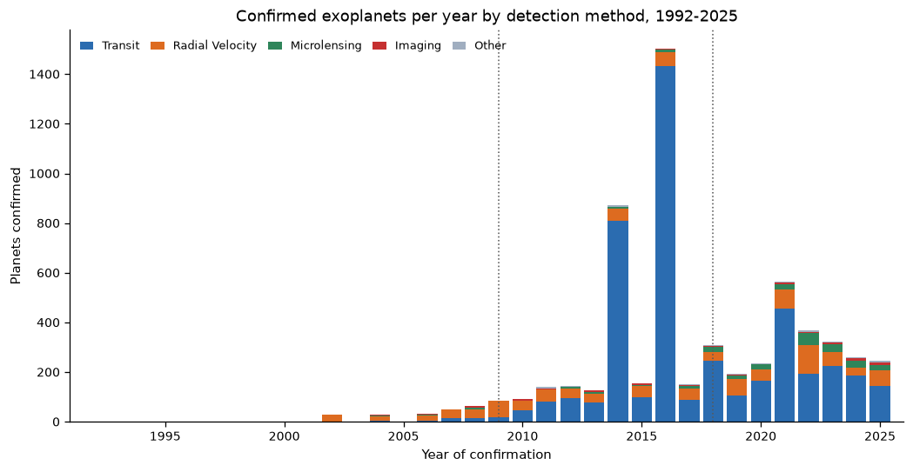
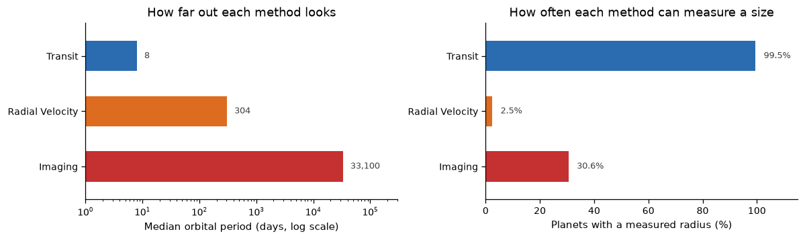

# Exoplanet Catalogue: a map of planets, or a map of telescopes?

**Research question.** The NASA Exoplanet Archive now lists 6,451 confirmed planets. Does the shape of that catalogue describe the underlying population of planets, or the instruments that found them?

**Short answer.** Mostly the instruments. Transit photometry alone accounts for 74% of everything confirmed, and each detection method reports a systematically different kind of planet. Statements of the form "the most common planet is ..." describe the detection pipeline at least as much as they describe the Galaxy.

This repository contains the full analysis, the data snapshot it runs on, and the three figures below.

---

## Data

| | |
|---|---|
| Source | [NASA Exoplanet Archive](https://exoplanetarchive.ipac.caltech.edu/), Planetary Systems (`ps`) table |
| Selection | `default_flag = 1` — one row per confirmed planet |
| Snapshot | 20 October 2026: **6,451 planets**, 4,847 host stars, 1992–2026 |
| Format | CSV, 12 columns, 823 KB (`data/ps.csv`) |
| Access | [TAP service](https://exoplanetarchive.ipac.caltech.edu/docs/TAP/usingTAP.html) |

The snapshot was retrieved with:

```sql
SELECT pl_name, hostname, disc_year, discoverymethod, disc_facility,
       pl_orbper, pl_rade, pl_bmasse, pl_orbsmax, st_teff, st_mass, sy_dist
FROM ps
WHERE default_flag = 1
```

**Usage permissions.** NASA Exoplanet Archive data are publicly available for research and educational use; no registration or licence fee is required. The archive asks that any use be acknowledged (see [Acknowledgment](#acknowledgment) below). The dataset contains no personal or sensitive information. The CSV is committed here so the analysis is reproducible offline; it can be refreshed at any time with the query above.

## Methods and tools

- **Tooling:** Python 3, pandas, matplotlib, Jupyter. No proprietary data or services.
- **Cleaning:** missing values arrive as `\N` or empty strings and are read as `NaN`; the eleven detection methods are grouped into the four largest plus `Other`; 2026 is excluded from the yearly chart because the snapshot was taken in October and the year is incomplete.
- **Analysis:** counts and coverage by method, missingness per column, discovery history by year, and the distributions of radius and mass against orbital period.
- **Reproducibility:** every number in this README is produced by `analysis.ipynb`, which reads only `data/ps.csv`.

## Key findings

1. **The catalogue is one instrument's view.** Transit photometry accounts for 74% of confirmed planets (4,785 of 6,451), and 1,504 planets arrived in 2016 alone, when Kepler candidates were confirmed in bulk.
2. **Each method reaches a different distance.** Median orbital period is 8 days for transits, 304 days for radial velocity, and 33,100 days — roughly 90 years — for direct imaging.
3. **Size is the most method-bound property.** Transits have a radius for 99.5% of their planets, radial velocity for 2.5%, and microlensing for none. All 30 imaged planets with a measured radius are larger than 10 Earth radii (median 15.2).






## Limitation

The catalogue contains only *confirmed* planets, and confirmation is not a random process: it depends on follow-up telescope time, which is allocated unevenly across methods and years. There is no correction for the number of stars observed or the sensitivity actually achieved by each survey, and 25% of rows have no radius while 51% have no mass. The distributions above are therefore shaped by selection and should be read as lower bounds, not as an unbiased census of planets.

## Run it

```bash
git clone https://github.com/CuiJeremy/data-science-project.git
cd data-science-project
pip install -r requirements.txt
jupyter lab analysis.ipynb
```

The notebook runs offline: it reads `data/ps.csv` and writes its figures to `figures/`.

## Project structure

```
data-science-project/
├── analysis.ipynb                    # the whole analysis, executed, with outputs
├── data/ps.csv                       # confirmed-planet snapshot, 20 Oct 2026
├── figures/
│   ├── fig1_discoveries_by_method.png
│   ├── fig2_radius_and_mass.png
│   └── fig3_method_blind_spots.png
├── requirements.txt
└── README.md
```

## Acknowledgment

This research has made use of the NASA Exoplanet Archive, which is operated by the California Institute of Technology, under contract with the National Aeronautics and Space Administration under the Exoplanet Exploration Program.

---

*Author: CUI JUNRUI. Analysis and figures produced for a data-science portfolio assignment; the code is free to reuse with attribution.*
